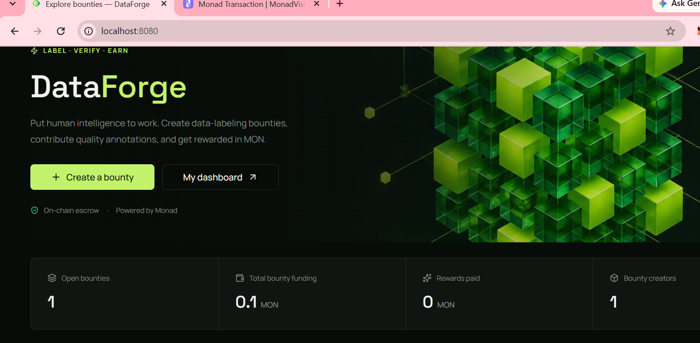
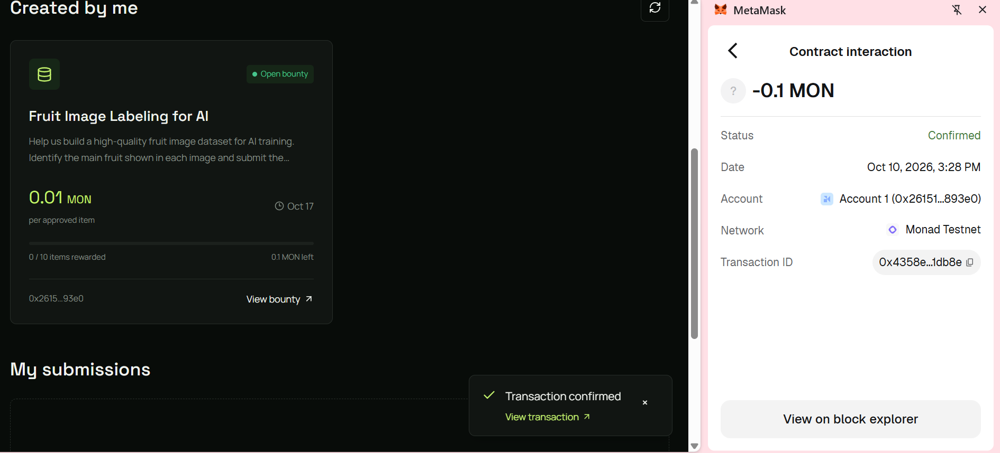
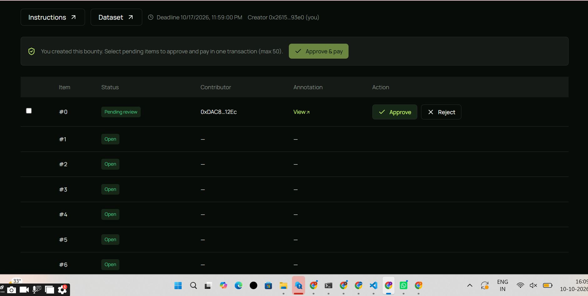
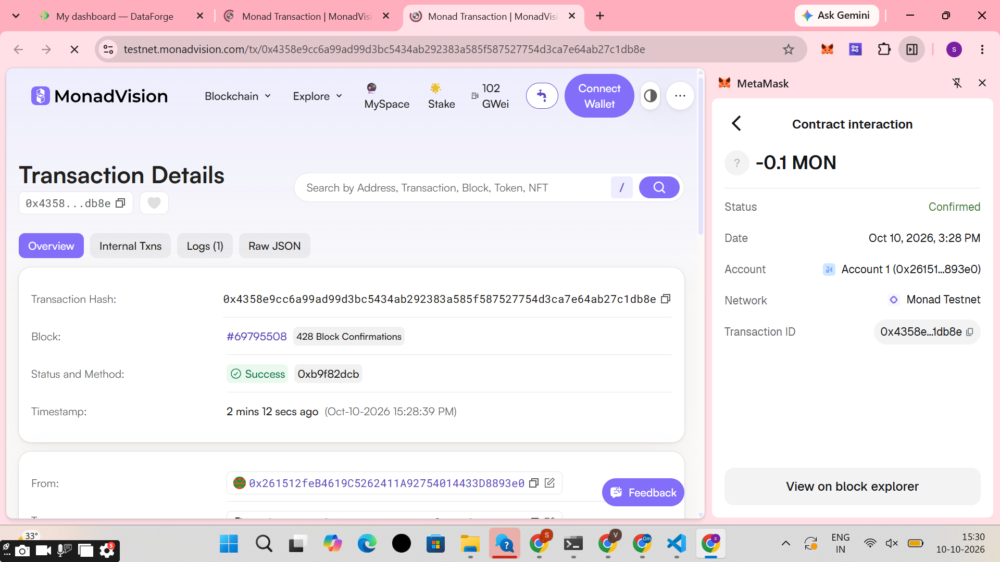

### A blockchain-powered marketplace for data-labeling bounties.

**Create bounties. Label data. Verify contributions. Earn rewards.**

DataForge connects dataset creators with contributors who complete annotation tasks. Creators fund bounties, contributors submit labels, and creators review submissions before eligible rewards are paid through a smart contract.

p align="center">
  <a href="https://monad-hackathon1.vercel.app"><strong> Live Demo</strong></a>
  ·
  <a href="https://github.com/sakshichavan-sc/Monad-hackathon"><strong> Source Code</strong></a>
  ·
  <a href="https://testnet.monadexplorer.com/address/0xbb6972aa4d393a8142afe67151ffe86d2d21cb9b"><strong>🔎 Contract on Monad Explorer</strong></a>
</p>

Network: Monad Testnet · Chain ID: 10143


---

## 🎯 The Problem

AI systems depend on high-quality labeled datasets. However, organizing annotation tasks, reviewing contributions, and coordinating contributor rewards can be challenging.

DataForge explores a blockchain-based approach to make bounty funding and reward transactions independently verifiable.

## 💡 Our Solution

DataForge brings dataset annotation and Web3 incentives into one workflow.

- **For creators:** Publish data-labeling tasks and fund reward pools.
- **For contributors:** Discover tasks and submit annotations.
- **For reviewers:** Review submissions and approve or reject work.
- **For transparency:** Inspect supported bounty and reward transactions on-chain.

## 🖥️ Product Showcase

### 01. Creator Dashboard

Manage bounties, review submitted annotations, and monitor reward information.

### 02. Data-Labeling Bounty

Explore the Image Labeling for AI demo and its annotation task.

### 03. On-Chain Transaction Proof

Inspect the confirmed Monad Testnet transaction used in the demo.

[**Open the bounty contract on Monad Explorer →**](https://testnet.monadexplorer.com/address/0xbb6972aa4d393a8142afe67151ffe86d2d21cb9b)

### 04. My Bounties

View created bounties, reward pools, and available progress information.

---

## ⚙️ How It Works

```text
       BOUNTY CREATOR
             |
             v
      Create and Fund
          a Bounty
             |
             v
     CONTRIBUTOR LABELS
          THE DATA
             |
             v
      Submit Annotation
             |
             v
       CREATOR REVIEWS
        THE SUBMISSION
             |
          +--+--+
          |     |
       Approve Reject
          |
          v
   Eligible Reward Payment
```

### 1. Create and fund

A creator connects an EVM-compatible wallet, enters the task details, supplies dataset and instruction URLs, configures the item count and reward, and confirms the funding transaction.

### 2. Submit annotations

Contributors access the dataset and submit annotation content for review. The frontend hashes the supplied UTF-8 content using `keccak256`.

### 3. Review submissions

The creator reviews pending work and approves or rejects submissions according to the deployed contract's rules.

### 4. Reward contributors

Eligible approved submissions can receive rewards from the bounty escrow. Claims and refunds depend on the contract's supported functions and eligibility rules.

---

## ⛓️ Monad Testnet Integration

DataForge uses Monad Testnet to demonstrate blockchain-based bounty funding and transaction verification.

| Configuration | Value |
|---|---|
| Network | Monad Testnet |
| Chain ID | `10143` |
| Currency | Testnet MON |
| Contract address | `0xbb6972aa4d393a8142afe67151ffe86d2d21cb9b` |
| RPC endpoint | `https://testnet-rpc.monad.xyz` |
| Fallback RPC | `https://rpc-testnet.monadinfra.com` |
| Explorer | [Monad Testnet Explorer](https://testnet.monadexplorer.com/) |

**Example bounty configuration**

| Parameter | Value |
|---|---:|
| Dataset task | Fruit Image Labeling for AI |
| Number of items | 10 |
| Reward per item | 0.01 MON |
| Total reward pool | 0.1 MON |

The example reward pool is calculated as 10 × 0.01 MON = 0.1 MON, excluding network fees.

**Important:** These values describe the example bounty configuration. They do not independently prove that every item was completed or that all rewards have been paid.

[**View the deployed contract →**](https://testnet.monadexplorer.com/address/0xbb6972aa4d393a8142afe67151ffe86d2d21cb9b)

The frontend ABI is located at `src/lib/blink-abi.ts`. Verify the deployed address and network before interacting with the contract.

---

## ✨ Key Features

- **Wallet connection:** Connect an injected EVM wallet such as MetaMask.
- **Bounty creation:** Configure task descriptions, public URLs, item counts, rewards, and deadlines.
- **Bounty discovery:** Browse tasks and open individual bounty pages.
- **Annotation submissions:** Submit annotation content for review.
- **Content hashing:** Hash submitted UTF-8 content with `keccak256`.
- **Submission review:** Approve or reject submissions through the supported contract workflow.
- **Reward and escrow handling:** Interact with contract-supported payments, claims, or refunds when eligible.
- **Dashboard:** Inspect bounties, submissions, deadlines, and reward information.
- **Explorer verification:** Open blockchain transaction records for supported actions.

Feature availability depends on the deployed contract, wallet state, and on-chain eligibility. The complete submission-to-payout workflow must be tested independently before being described as fully verified.

## 🛠️ Technology Stack

| Technology | Purpose |
|---|---|
| React 19 | User interface |
| TypeScript | Application logic and type safety |
| TanStack Start / Router / Query | Routing and data fetching |
| Vite | Development and build tooling |
| Tailwind CSS v4 | Styling |
| shadcn/ui | Interface components |
| viem | EVM interaction, transaction handling, and hashing |
| Monad Testnet | Blockchain test environment |

## 📂 Project Structure

```text
src/
├── components/
│   ├── app-shell.tsx
│   └── bounties.tsx
├── lib/
│   ├── contract.ts
│   └── blink-abi.ts
├── routes/
│   ├── index.tsx
│   ├── create.tsx
│   ├── dashboard.tsx
│   └── bounty.$id.tsx
└── test/

docs/
└── screenshots/
    ├── creator-dashboard.png
    ├── bounty-details.png
    ├── monad-transaction.png
    └── my-bounties.png
```

## 🚀 Run Locally

### Prerequisites

- Node.js compatible with the project's toolchain, or Bun
- Git
- MetaMask or another injected EVM-compatible wallet
- Monad Testnet configured in the wallet

### Installation

Clone the repository:

```bash
git clone YOUR_GITHUB_REPOSITORY_URL
cd YOUR_PROJECT_FOLDER
```

Install dependencies with Bun:

```bash
bun install
bun run dev
```

Or use npm:

```bash
npm install
npm run dev
```

Open the local URL printed in your terminal. The current project setup uses port `8080`.

### Tests and production build

Using Bun:

```bash
bun run test
bun run build
```

Using npm:

```bash
npm test
npm run build
```

Use the package scripts defined in `package.json` as the source of truth for available commands.

## 🔐 Dataset, Privacy and Security

- Dataset files and task instructions must be hosted at publicly accessible HTTP(S) or IPFS URLs.
- DataForge does not automatically upload dataset files for you.
- Confirm that every dataset and instruction URL works before funding a bounty.
- Bounty details and on-chain submissions may be publicly visible.
- Never submit passwords, private keys, seed phrases, personal data, or confidential dataset content.
- Annotation hashes do not encrypt annotation content or make public information private.
- Never commit `.env` files, wallet secrets, or API credentials to source control.

## 🧪 Verification and Current Status

**Project status: Hackathon prototype on Monad Testnet.**

The demo includes a bounty interface, a data-labeling task, creator review functionality, and evidence of a confirmed funding transaction.

A confirmed funding transaction establishes that the specific transaction was confirmed; it does not establish that contributor submissions, approvals, payouts, claims, or refunds have all passed end-to-end testing.

Before presenting the complete workflow as verified, test it with separate creator and contributor wallets and inspect the resulting transactions.

## 🔮 Future Scope

- Automated annotation quality checks
- Contributor reputation and quality scoring
- Support for additional datasets and annotation formats
- Improved reward tracking and contributor history
- More transparent verification and dispute-resolution workflows
- Expanded tools for dataset creators and contributors

## 🏆 Our Vision

We want to make data labeling more accessible, transparent, and rewarding by connecting people who need quality datasets with contributors who can produce them.

DataForge explores how blockchain-based bounties can support a community-driven approach to AI training data.

---
---

## 📸 Project Screenshots

### 1. Bounty Dashboard


### 2. Bounty Created


### 3. Approve the Work


### 4. Monad Explorer Transaction
